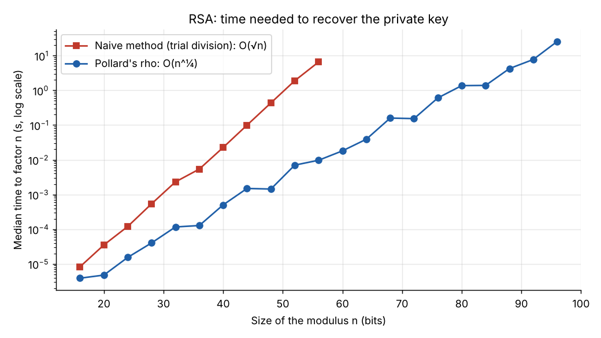
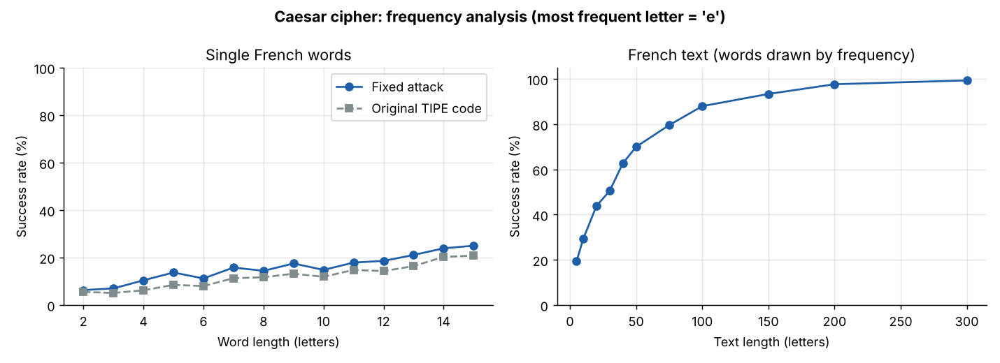
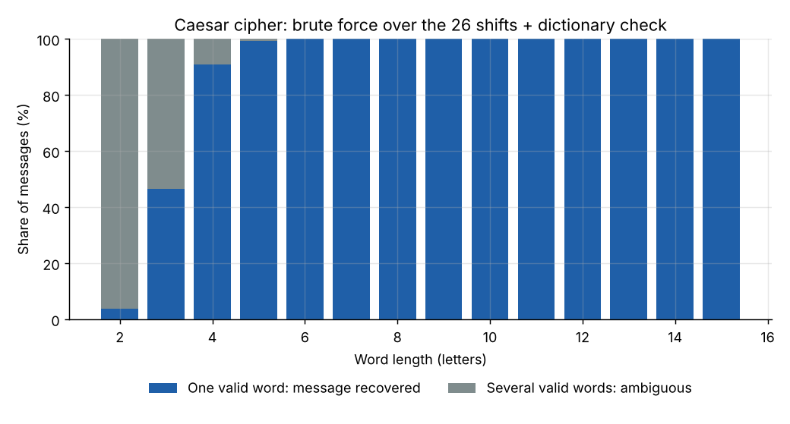
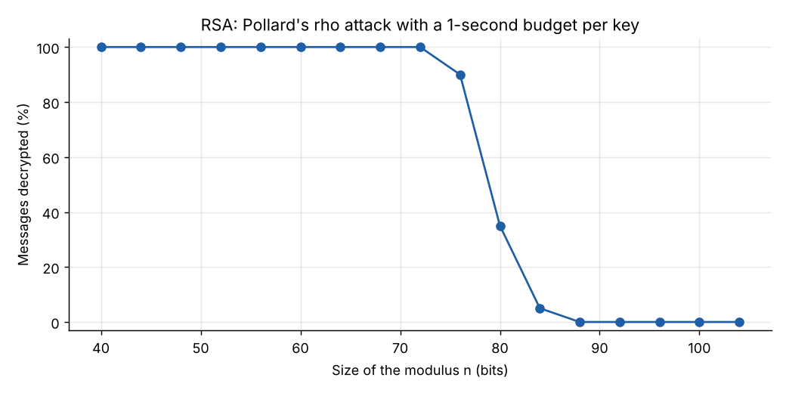

# Cryptanalyse : du code de César à RSA

> 🇬🇧 [English version](README.md)

**À quel point est-il difficile de lire un message chiffré sans la clé ?** Implémentation de deux systèmes de chiffrement, le code de César et RSA, et attaques expérimentales contre eux : analyse de fréquences et force brute pour César, factorisation de la clé publique par la méthode naïve et par l'algorithme ρ de Pollard pour RSA.

*TIPE (MP option informatique) · 2024–2025 · Samuel Placek · Thème : « Transition, transformation, conversion »*



## Principaux résultats

**Code de César**
- **L'analyse de fréquences** (« la lettre la plus fréquente correspond au *e* ») n'est pas fiable sur un mot isolé : **de 6 % à 25 % de réussite** selon sa longueur. Il lui faut un vrai texte : **88 % de réussite sur 100 lettres, 99 % sur 300**.
- **La force brute** sur les 26 décalages, avec une vérification automatique dans le dictionnaire, retrouve toujours le mot d'origine parmi les candidats. La réponse est unique pour **plus de 99 % des mots de 5 lettres ou plus** ; les mots très courts restent ambigus (96 % des mots de 2 lettres ont plusieurs déchiffrements valides).

**RSA**
- **La méthode naïve** (essais de divisions) demande environ √n opérations : son temps est multiplié par environ 4 tous les 4 bits du module n, et elle prend déjà 6,6 secondes pour un n de 56 bits.
- **L'algorithme ρ de Pollard** demande environ n^¼ opérations, il croît donc deux fois moins vite : il factorise **un module de 96 bits en environ 26 secondes**. Avec 1 seconde par clé, il déchiffre **100 % des messages jusqu'à 72 bits**, et plus aucun à partir de 88 bits.
- Extrapolé à une vraie **clé de 2 048 bits** (temps doublé tous les 4 bits à partir des 26 secondes mesurées à 96 bits), Pollard ρ demanderait environ **10^140 ans** : le RSA utilisé en pratique résiste à ces attaques. Seul un grand ordinateur quantique exécutant **l'algorithme de Shor** factoriserait n en temps polynomial.
- **Bonus :** chiffrer lettre par lettre, comme dans ce projet, est en soi une faiblesse. Une lettre donne toujours le même nombre : il suffit de chiffrer les 26 lettres avec la clé publique pour lire n'importe quel message, quelle que soit la taille de la clé (`codebook_attack`). C'est pourquoi le vrai RSA ajoute un bourrage aléatoire (OAEP) avant de chiffrer.

| | |
|---|---|
|  |  |
|  | |

## Principe

**Code de César.** Chaque lettre de rang x (a = 0, …, z = 25) devient x + k mod 26. Il n'existe que 26 clés possibles.

**RSA.** On choisit deux nombres premiers p et q, on pose n = pq et φ(n) = (p − 1)(q − 1), on prend e premier avec φ(n) (65 537 en pratique) et on calcule d, l'inverse de e modulo φ(n).
- Clé publique (n, e) : une lettre de rang x est chiffrée en y = x^e mod n.
- Clé privée d : x = y^d mod n. La démonstration repose sur le petit théorème de Fermat (voir l'annexe des [slides](docs/TIPE_slides_fr.pdf)).

**Attaque.** Factoriser n donne p et q, donc φ(n) et d : toute la sécurité de RSA repose sur la difficulté de la factorisation.
- *La méthode naïve* teste tous les diviseurs impairs jusqu'à √n.
- *Pollard ρ* itère x ↦ x² + c mod n. Modulo le facteur inconnu p, cette suite vit dans un ensemble fini : elle finit par boucler (la forme de la lettre ρ). « La tortue et le lièvre » de Floyd détectent le cycle : x avance d'un pas, y de deux, et pgcd(|x − y|, n) révèle p dès que x ≡ y (mod p). D'après le paradoxe des anniversaires, il faut environ √p ≈ n^¼ étapes.

## Lancer le projet

```bash
pip install -r requirements.txt
python -m pytest                               # 108 tests
python experiments/run_experiments.py --quick  # toutes les expériences en 1 minute environ (dans figures_quick/)
```

L'exécution complète (`python experiments/run_experiments.py`, environ 10 minutes) régénère `figures/` et les résultats bruts dans `results/` ; `--plot-only` redessine les figures à partir de `results/`. Les temps ont été mesurés sur une machine x86_64 standard avec Python 3.13 : les valeurs absolues varient d'un ordinateur à l'autre, pas les vitesses de croissance.

```python
from cryptanalysis import rsa, attacks

public, private = rsa.generate_keys(64)            # module n de 64 bits
cipher = rsa.encrypt("bonjour", public)
attacks.break_rsa(cipher, public)                  # 'bonjour', avec la seule clé publique
```

## Structure du projet

```
cryptanalysis/
  words.py        Liste de mots français : mots et textes aléatoires, recherche dans le dictionnaire
  caesar.py       Code de César, analyse de fréquences, force brute
  rsa.py          Génération de clés (nombres premiers par Miller-Rabin), chiffrement, déchiffrement
  attacks.py      Méthode naïve, Pollard ρ, attaque complète, attaque par dictionnaire de codes
experiments/      run_experiments.py : toutes les expériences et figures
tests/            Tests unitaires (pytest)
data/             words_fr.tsv : 77 824 mots français avec leur fréquence
scripts/          build_wordlist.py : reconstruit la liste de mots à partir de Lexique
figures/          Figures générées
results/          Résultats bruts (CSV)
docs/             Slides originales du TIPE
```

## Changements depuis le TIPE original (2025)

Le code a été réécrit et toutes les expériences ont été relancées :
- **Chiffrement et déchiffrement RSA corrigés** : ils n'étaient pas réciproques, et le déchiffrement calculait y^d sans réduire modulo n, ce qui le rendait impossible au-delà d'environ 12 bits. Les deux utilisent désormais l'exponentiation modulaire.
- **Tailles de clé corrigées** : le « nombre de bits de n » des slides était en fait la taille de p et q, donc n était deux fois plus grand. Les nouvelles figures utilisent la vraie taille de n.
- **Analyse de fréquences de César corrigée** : le décalage était calculé par |rang(e) − rang(k)|, ce qui échoue dès que le *e* est chiffré en a, b, c ou d. Il est maintenant calculé modulo 26 (la courbe « Original TIPE code » montre la différence).
- **Force brute automatique** : les candidats sont vérifiés dans le dictionnaire au lieu d'être lus à la main.
- **Pollard ρ plus robuste** : il recommence avec une autre constante au lieu d'échouer quand le pgcd vaut n ; limite de temps pour les expériences.
- Calculs exacts en entiers (φ(n), inverse modulaire), génération de nombres premiers par Miller–Rabin, tests unitaires, expériences reproductibles (graine aléatoire fixée).

## Crédits

Liste de mots tirée de [Lexique 3.83](http://www.lexique.org) (New, Pallier et al.), distribué sous licence CC BY-SA 4.0 ; `data/words_fr.tsv` est partagé sous la même licence.

**Samuel Placek**, MP option informatique, 2024–2025
